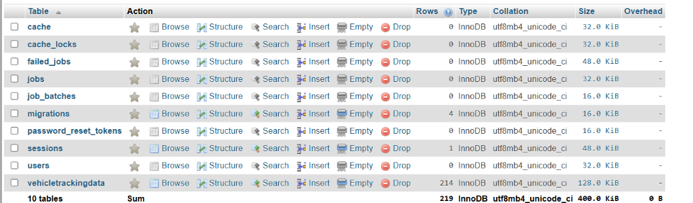
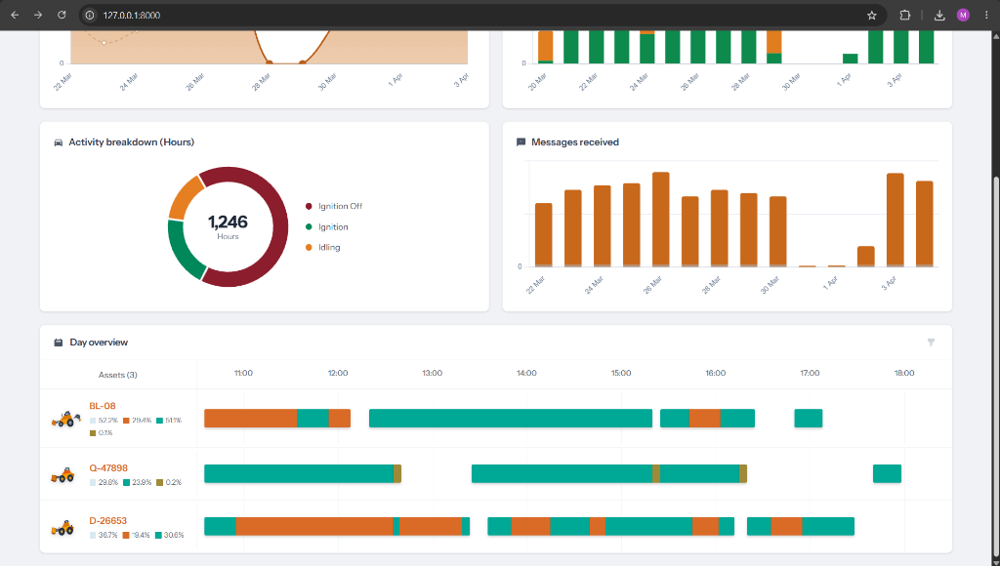
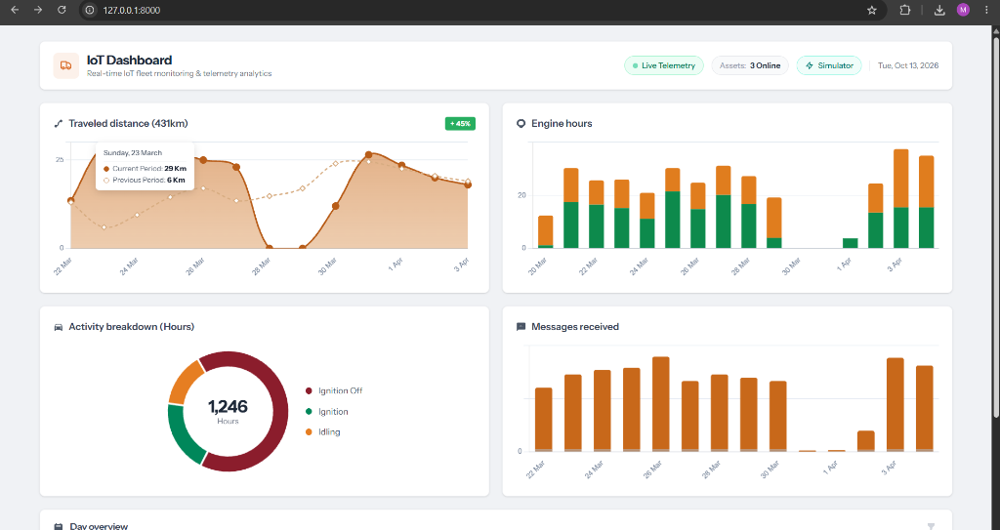
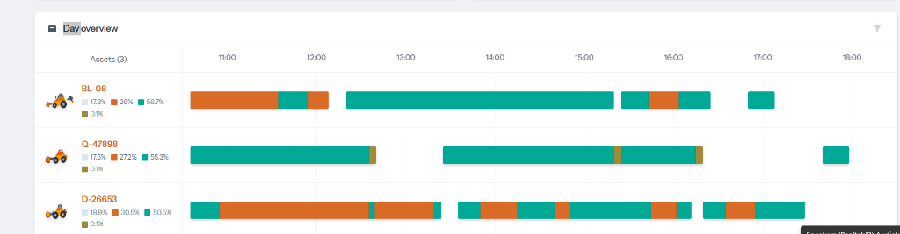

# IoT Fleet Telemetry Dashboard

An interactive IoT Vehicle Telemetry Dashboard built with **Laravel 13**, **Vue.js 3**, **Chart.js**, and **MySQL**. It monitors fleet activity in real-time, displays aggregated fleet metrics (travelled distance, engine hours, ignition status, activity breakdown, and message volume), provides interactive daily timelines, and includes an IoT telemetry simulator.

---

## 📸 Screenshots

### Dashboard Overview


### Fleet Activity & Analytics Charts


### Day Overview & Timeline


### Live IoT Telemetry Records


---

## 🚀 Key Features

- **Live Telemetry Monitoring:** Real-time updates and historical feed of vehicle telemetry data (GPS coordinates, speed, ignition status, engine hours, idling duration).
- **Interactive Fleet Analytics:**
  - **Travelled Distance:** Daily distance tracking per vehicle.
  - **Engine Hours & Idling:** Engine runtime versus idle duration.
  - **Activity Breakdown:** Donut chart displaying Driving, Idling, and Stopped distribution.
  - **Messages Received:** IoT telemetry message volume tracking.
- **Day Overview & Activity Timeline:** 24-hour visual timeline of trips, stops, and idling periods.
- **Filtering:** Vehicle-specific filtering and custom date range filters.
- **Built-in IoT Simulator (`/iot`):** Standalone telemetry generator sending continuous live records to test real-time dashboard updates without external hardware.

---

## 🛠️ Technology Stack

- **Backend:** Laravel 13.x, PHP 8.4
- **Frontend:** Vue.js 3 (Composition API), Vite, Tailwind CSS
- **Data Visualization:** Chart.js 4.x
- **Database:** MySQL
- **HTTP Client:** Axios

---

## ⚙️ Installation & Setup

### Prerequisites
- PHP >= 8.2 (PHP 8.4 recommended)
- Composer
- Node.js >= 18.x & npm
- MySQL

### 1. Clone the Repository
```bash
git clone https://github.com/naveeshaikh8-pixel/latinemIotDashboard.git
cd latinemIotDashboard
```

### 2. Install Dependencies
```bash
# Install PHP dependencies
composer install

# Install Frontend dependencies
npm install
```

### 3. Environment Configuration
Copy the `.env.example` file to `.env`:
```bash
cp .env.example .env
php artisan key:generate
```

Configure your MySQL database connection in `.env`:
```env
DB_CONNECTION=mysql
DB_HOST=127.0.0.1
DB_PORT=3306
DB_DATABASE=latinemIotDashboard
DB_USERNAME=root
DB_PASSWORD=your_password
```

### 4. Database Migration & Seeding
Run migrations and populate historical sample fleet tracking data:
```bash
php artisan migrate
php artisan db:seed --class=VehicleTrackingDataSeeder
```

### 5. Compile Frontend Assets
For local development with hot reload:
```bash
npm run dev
```
Or build for production:
```bash
npm run build
```

### 6. Run the Application
```bash
php artisan serve
```
Open your browser and navigate to:
- **Dashboard:** `http://localhost:8000/`
- **IoT Simulator:** `http://localhost:8000/iot`

---

## 📡 API Endpoints

| Method | Endpoint | Description |
| :--- | :--- | :--- |
| `GET` | `/api/vehicles` | Returns distinct vehicle list |
| `GET` | `/api/tracking/summary` | Aggregated dashboard KPIs |
| `GET` | `/api/tracking/travelled-distance` | Distance grouped by day |
| `GET` | `/api/tracking/engine-hours` | Engine hours & idling duration |
| `GET` | `/api/tracking/activity-breakdown` | Driving / Idling / Stopped breakdown |
| `GET` | `/api/tracking/messages-received` | Message volume per vehicle |
| `GET` | `/api/tracking/timeline` | 24-hour timeline activity segments |
| `GET` | `/api/tracking/latest-feed` | Latest IoT telemetry records |
| `POST` | `/api/iot/simulate` | Generates simulated IoT telemetry records |

---

## 📄 License
This project is open-source and licensed under the [MIT license](LICENSE).
